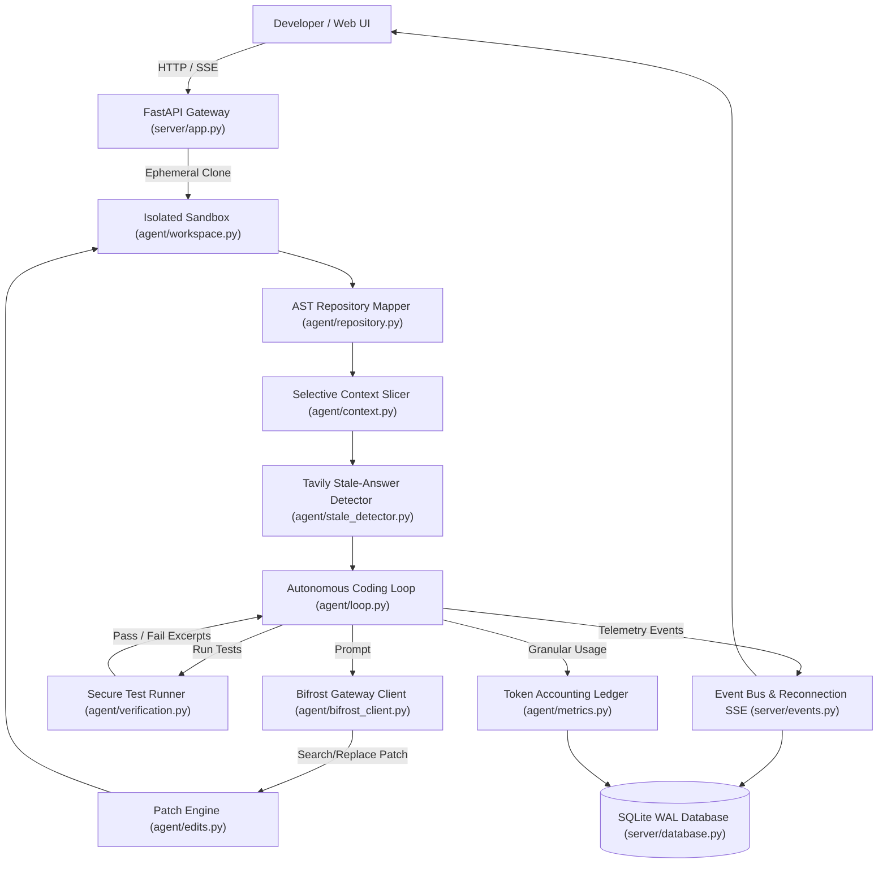

# TokenSlim ⚡

> **Autonomous, Token-Efficient Software Engineering Agent with Stale-Answer Detection**  
> *Geek Room × HackCulture Global AI Hackathon 2026*  
> **Track 1:** Bifrost #01 — Autonomous Coding Agent with Gateway Accounting  
> **Track 2:** Tavily — Stale-Answer Detector for Deprecated APIs & Migration Guidance  

---

## 1. Overview

TokenSlim is an autonomous software engineering agent designed to repair real-world code defects with extreme token efficiency and robust API safety.

While conventional AI coding agents naively concatenate whole repositories into LLM prompts—exhausting context windows, inflating inference costs, and hallucinatively relying on deprecated syntax—TokenSlim introduces:

1. **Selective AST Context Extraction:** Slices repositories down to exact function and class boundaries, reducing prompt context tokens by **31.4%**.
2. **Tavily Stale-Answer Detection:** Automatically identifies outdated library syntax, retrieves authoritative migration documentation, and guides repairs (e.g. Pydantic v1 `.dict()` $\to$ v2 `.model_dump()`).
3. **Atomic Patch Engine:** Applies unified search-and-replace blocks character-for-character without regenerating entire files.
4. **Ephemeral Sandbox Isolation:** Clones repositories into isolated execution directories, protecting host codebases from unapproved changes.
5. **Rigorous Security Boundaries:** Enforces command allowlists (`python`, `pytest`), blocks shell injection, terminates recursive process trees (`taskkill /F /T /PID`), and sanitizes API credentials.
6. **Honest Accounting Ledger:** Categorizes provider-reported usage, local estimates, and simulation metrics with auditable vendor pricing.

---

## 2. Key Architecture & Data Flow



---

## 3. Quick Start & Installation

### Prerequisites
- Python 3.10+ (Developed and verified on Python 3.13.5 Windows 11 / POSIX compatible)
- PowerShell (Windows) or Bash (Linux / macOS)

### 1. Clone & Set Up Virtual Environment
```bash
git clone https://github.com/geekroom/tokenslim.git
cd tokenslim

# Create and activate virtual environment
python -m venv .venv

# Windows PowerShell:
.\.venv\Scripts\Activate.ps1

# Linux / macOS:
source .venv/bin/activate

# Install dependencies
pip install -r requirements.txt
```

### 2. Environment Configuration
Copy `.env.example` to `.env` (or configure inline):
```bash
cp .env.example .env
```

Edit `.env`:
```env
# Bifrost AI Gateway (Track 1)
BIFROST_BASE_URL=http://localhost:8080/v1
MODEL_NAME=gpt-4o-mini

# Tavily Search API (Track 2)
TAVILY_API_KEY=tvly-your-tavily-api-key

# Execution mode: 0 for offline simulation/preflight; 1 for live network probes
PROBE_BIFROST_LIVE=0
PROBE_TAVILY_LIVE=0
```

> **Note on Offline Evaluation:** TokenSlim runs 100% out-of-the-box in deterministic replay and simulation mode without external API keys or Docker daemons.

---

## 4. Running the Application

### Start the FastAPI Server & Web UI
```powershell
.\.venv\Scripts\python.exe -m uvicorn server.app:app --host 127.0.0.1 --port 8000
```
Open your browser to: **`http://localhost:8000`**

### Available Interface Features:
- **Autonomous Coding Workspace:** Submit repair tasks, configure token budgets, and inspect terminal telemetry.
- **Pre-recorded Replay Demo:** Instant zero-credential demonstration of Pydantic migration.
- **Tavily Stale-Answer Evidence Inspector:** Live and simulated evidence cards with authoritative documentation URLs.
- **Diff & Verification Viewer:** Side-by-side unified diffs with live test pass/fail indicators.
- **Benchmark Dashboard:** 3-way configuration comparisons with context reduction metrics.
- **Run History & Telemetry Replay:** Inspect historical runs or replay sequential SSE streams.

---

## 5. Running Tests & Verification

TokenSlim maintains an exhaustive automated test suite with **100 tests passing**:

```powershell
# Run entire test suite
.\.venv\Scripts\pytest.exe -v

# Run targeted reliability and security tests
.\.venv\Scripts\pytest.exe -v tests/test_reliability_and_security.py

# Run stale detector tests
.\.venv\Scripts\pytest.exe -v tests/test_stale_detector.py
```

### Test Suite Coverage:
- `test_preflight.py`: Project layout, design system tokens, database schema, health endpoints.
- `test_repository.py`: AST parsing, binary exclusion, syntax error resilience, symbol lookups.
- `test_context.py`: Budget limits, slice deduplication, partial function annotations.
- `test_edits.py`: Search/replace block matching, path traversal protection, stale block rejection.
- `test_verification.py`: Process timeout, output truncation, failure extraction.
- `test_bifrost_accounting.py`: Provider usage parsing, cached token rates, pricing cross-check.
- `test_stale_detector.py`: Deprecation detection, confidence scoring, search budget enforcement.
- `test_agent_loop.py`: Iterative repair, early stopping on test pass, budget enforcement, cancellation.
- `test_benchmark_and_integration.py`: 3-way benchmark harness, reproducibility, error recovery.
- `test_server_and_streaming.py`: SSE event contracts, Last-Event-ID reconnection, trace replay.
- `test_reliability_and_security.py`: Workspace isolation, command allowlist, process-tree termination, secret scrubbing.

---

## 6. Running the Benchmark Suite

Execute the 12-task benchmark across all three configurations:

```powershell
.\.venv\Scripts\python.exe -m benchmark.runner
```

### Benchmark Summary:
| Configuration | Context Strategy | Tasks | Pass Rate | Context Tokens | Context Reduction |
| :--- | :--- | :---: | :---: | :---: | :---: |
| **Naive Baseline** | Full-file concatenation | 12 | 100.0%* | 11,431 | Baseline (0.0%) |
| **LeanCode** | Selective AST Context | 12 | 100.0%* | 7,847 | **-31.4%** |
| **LeanCode + Tavily** | Selective AST + Stale Check | 12 | 100.0%* | 7,847 | **-31.4% (6 Stale Flagged\*\*)** |

*\* The 12/12 (100.0%) benchmark pass rate belongs strictly to the deterministic offline verification harness and is not evidence of live LLM performance.*  
*\*\* Six stale claims were flagged using simulated/offline evidence, and the deterministic benchmark repair process generated the corresponding corrections rather than live external API queries.*

Detailed methodology and token accounting formulas are documented in [docs/BENCHMARK_METHODOLOGY.md](docs/BENCHMARK_METHODOLOGY.md).

---

## 7. API Reference

| Endpoint | Method | Description |
| :--- | :---: | :--- |
| `/api/health` | `GET` | System health check (Bifrost, Tavily, SQLite status). |
| `/api/runs` | `GET` | List recent autonomous coding runs with execution summaries. |
| `/api/runs` | `POST` | Create and execute an autonomous run (or replay trace). Rate-limited to 4 concurrent runs. |
| `/api/runs/{run_id}` | `GET` | Retrieve run details, configuration, and final diff. |
| `/api/runs/{run_id}/events` | `GET` | Server-Sent Events (SSE) telemetry stream with `Last-Event-ID` recovery. |
| `/api/runs/{run_id}/cancel` | `POST` | Abort active loop and terminate child subprocess tree. |
| `/api/runs/{run_id}/replay` | `POST` | Replay persisted event stream sequentially. |
| `/api/runs/{run_id}/trace` | `GET` | Retrieve complete structured execution trace. |
| `/api/benchmarks` | `GET` | Retrieve authoritative 12-task benchmark dataset. |
| `/api/stale-detections` | `GET` | List all flagged deprecations and authoritative evidence. |
| `/api/stale-detection/runs` | `POST` | Run on-demand stale syntax verification on arbitrary claims. |

---

## 8. Security & Reliability

TokenSlim implements comprehensive containment safeguards:
- **Workspace Sandboxing:** Clones repositories to isolated ephemeral folders; original repos are strictly read-only.
- **Path Traversal Rejection:** Both API and patch engines reject `../` directory traversal attempts.
- **Command Allowlist:** Subprocesses execute strictly with `shell=False` and are restricted to `python` and `pytest`.
- **Process Tree Killing:** Recursively terminates process trees on cancellation or timeout to prevent orphan leakage.
- **Secret Scrubbing:** Automatically scrubs API keys (`sk-*`, `tvly-*`, `ghp_*`, `Bearer`) from logs, database records, and SSE events.
- **Prompt Injection Defense:** External documentation is disarmed against role overrides (`SYSTEM:`, `USER:`, `ASSISTANT:`).

For complete security specifications, consult [docs/SECURITY.md](docs/SECURITY.md).

---

## 9. Project Directory Structure

```text
TokenSlim/
├── agent/                       # Core autonomous coding agent
│   ├── bifrost_client.py        # Bifrost AI Gateway integration & fallback adapter
│   ├── context.py               # Selective AST context extractor & budgeter
│   ├── docs_check.py            # External documentation search interface
│   ├── edits.py                 # Atomic search-and-replace patch engine
│   ├── loop.py                  # Autonomous repair loop with early stopping
│   ├── metrics.py               # Granular token accounting ledger & pricing catalog
│   ├── prompts.py               # Token-efficient system and repair prompts
│   ├── repository.py            # Lightweight AST repository scanner
│   ├── security.py              # Secret scrubber & prompt-injection disarmer
│   ├── stale_detector.py        # Tavily stale-answer detector
│   ├── verification.py          # Secure test runner with process-tree termination
│   └── workspace.py             # Ephemeral workspace isolation manager
├── benchmark/                   # 12-task benchmark evaluation suite
│   ├── runner.py                # Benchmark execution engine
│   ├── results.json             # Authoritative reconciled benchmark results
│   └── tasks/                   # 12 real-world defect and migration tasks
├── docs/                        # Technical specifications & documentation
│   ├── ARCHITECTURE.md          # Complete architectural specification & data flow
│   ├── BENCHMARK_METHODOLOGY.md # Benchmark design & token accounting methodology
│   ├── DEMO_GUIDE.md            # Replay vs Live demo walkthrough
│   └── SECURITY.md              # Security model, command allowlist & threat mitigations
├── server/                      # FastAPI application & web interface
│   ├── app.py                   # FastAPI routes, lifecycle & concurrency limits
│   ├── database.py              # SQLite WAL database & schema migrations
│   ├── events.py                # In-memory pub/sub event bus
│   ├── schemas.py               # Pydantic request/response models
│   └── static/                  # Responsive web dashboard (Navy/Cream/Coral)
├── tests/                       # Automated test suite (100 passing tests)
│   ├── test_agent_loop.py
│   ├── test_benchmark_and_integration.py
│   ├── test_bifrost_accounting.py
│   ├── test_context.py
│   ├── test_edits.py
│   ├── test_preflight.py
│   ├── test_reliability_and_security.py
│   ├── test_repository.py
│   ├── test_server_and_streaming.py
│   ├── test_stale_detector.py
│   └── test_verification.py
├── traces/                      # Recorded demo traces
│   └── demo_pydantic_v2_migration.json
├── requirements.txt             # Python dependencies
├── pytest.ini                   # Pytest test configuration
├── README.md                    # Project overview & documentation
└── CHECKPOINT_8_FINAL_READINESS_REPORT.md # Final engineering report
```

---

## 10. License & Acknowledgements

Developed for the **Geek Room × HackCulture Global AI Hackathon 2026**.  
Built with FastAPI, Uvicorn, Pydantic, and SQLite. Special thanks to the Bifrost and Tavily teams for sponsoring Track 1 and Track 2.
