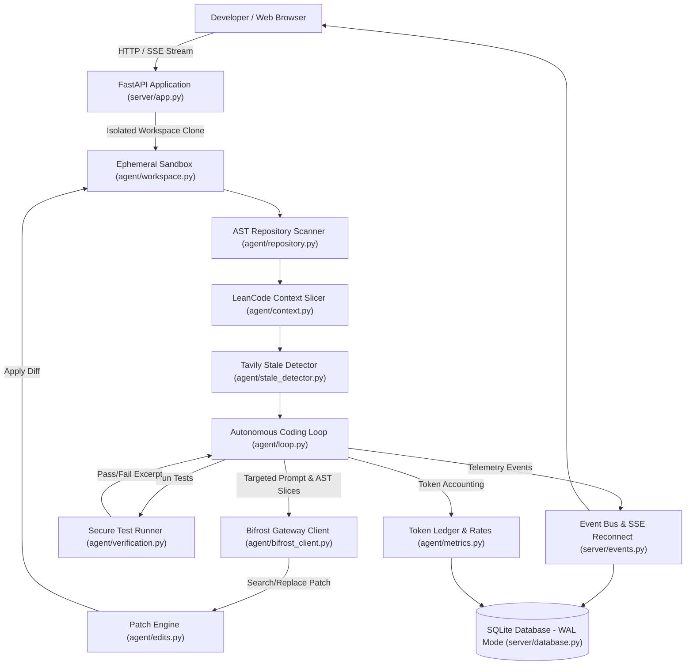
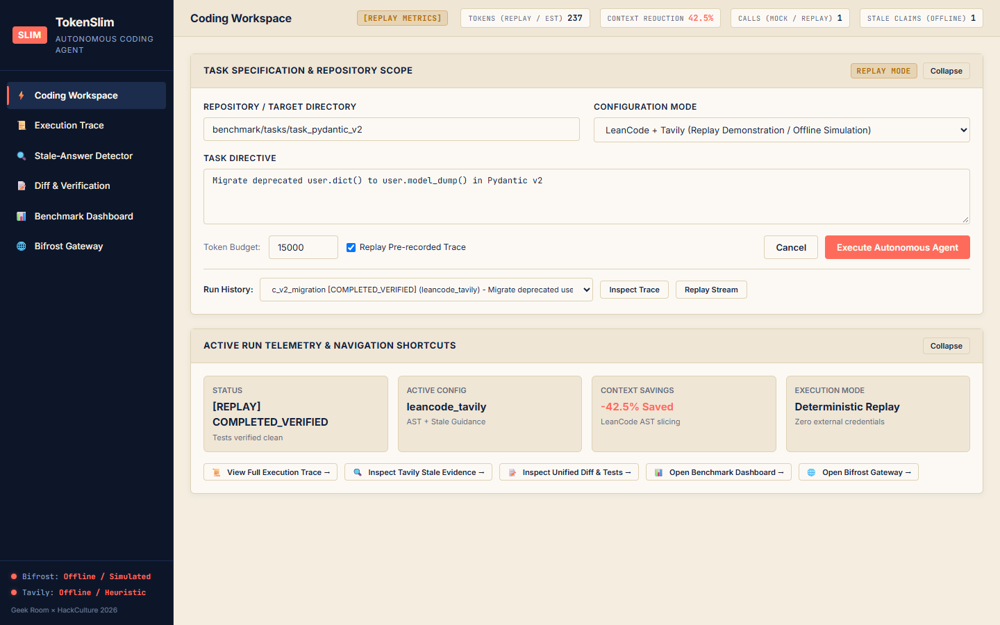
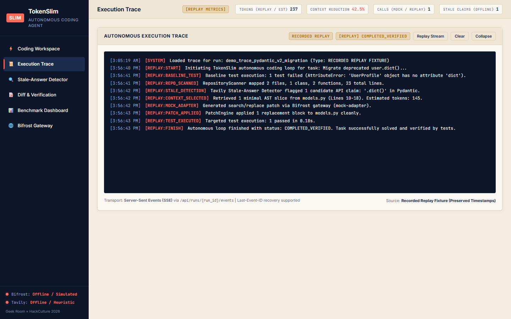
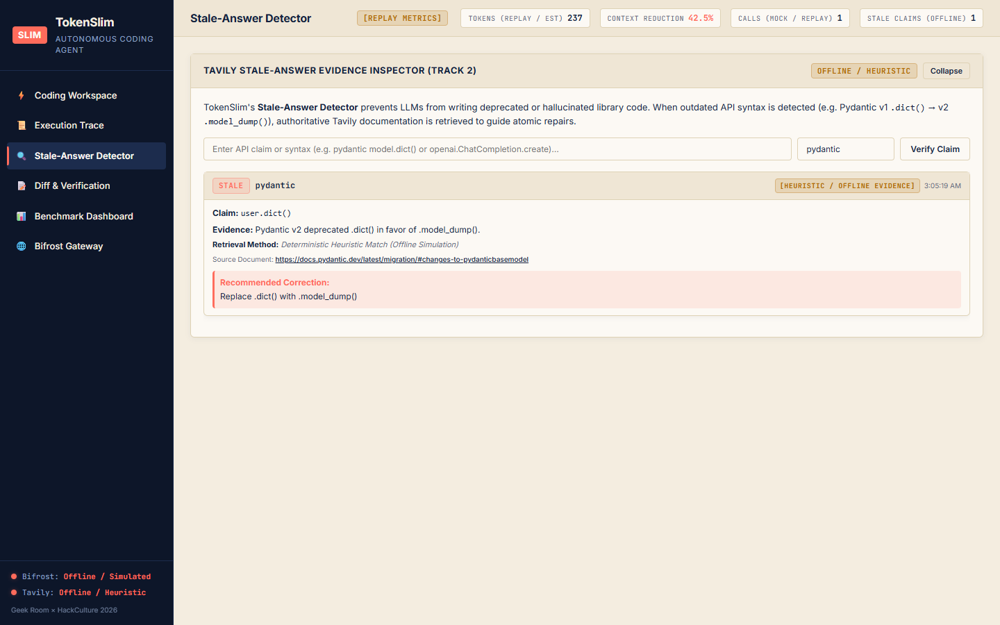
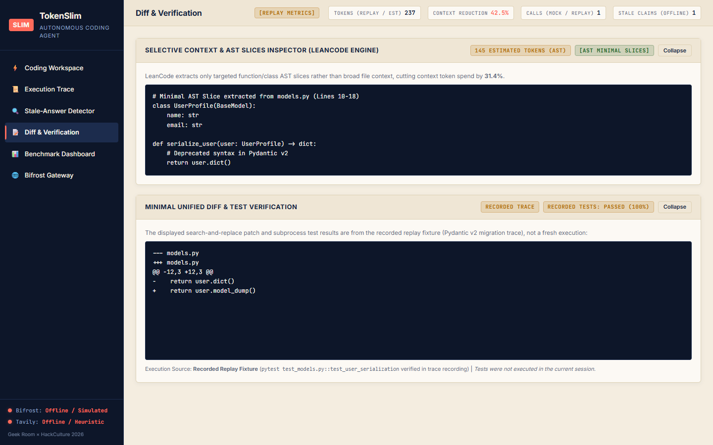
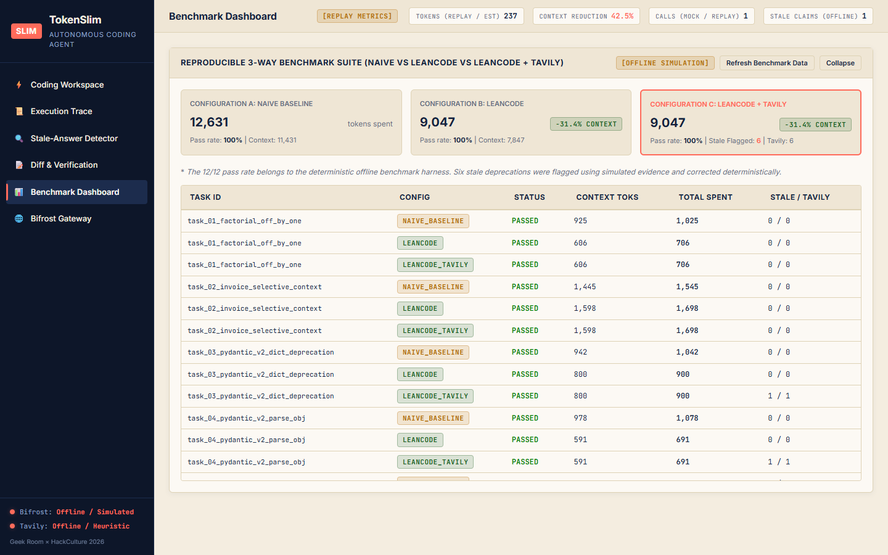
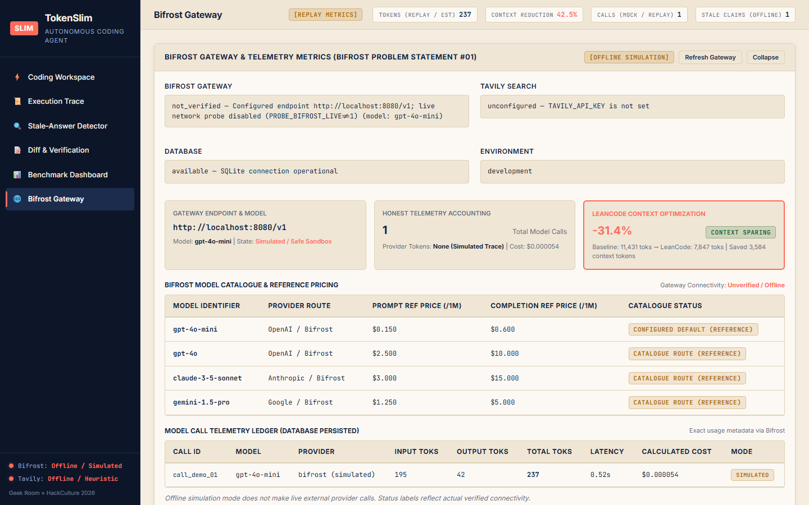

# TokenSlim ⚡

<div align="center">

**Autonomous, Token-Efficient Software Engineering Agent with Stale-Answer Detection**

[](https://www.python.org/)
[](https://fastapi.tiangolo.com)
[](tests/)
[](docs/benchmarks/BENCHMARK_METHODOLOGY.md)
[](LICENSE)
[](https://tokenslim-geekroom.onrender.com)

*Built for the Geek Room × HackCulture Global AI Hackathon 2026*  
**Track 1:** Bifrost Gateway #01 (Model Routing, Telemetry & Granular Token Accounting)  
**Track 2:** Tavily Stale-Answer Detection (API Deprecation Screening & Migration Guidance)

[Live Application](https://tokenslim-geekroom.onrender.com) • [Documentation Portal](docs/README.md) • [Architecture Guide](docs/architecture/ARCHITECTURE.md) • [Benchmark Suite](docs/benchmarks/BENCHMARK_METHODOLOGY.md)

</div>

---

## Table of Contents

- [1. Overview](#1-overview)
- [2. Core Features](#2-core-features)
- [3. System Architecture](#3-system-architecture)
- [4. Application Screenshots](#4-application-screenshots)
- [5. Benchmark Results & Verification](#5-benchmark-results--verification)
- [6. Installation & Setup](#6-installation--setup)
- [7. Environment Configuration](#7-environment-configuration)
- [8. Running the Application](#8-running-the-application)
- [9. Running the Automated Tests](#9-running-the-automated-tests)
- [10. Running the Benchmark Suite](#10-running-the-benchmark-suite)
- [11. API Overview](#11-api-overview)
- [12. Security Model & Defensive Controls](#12-security-model--defensive-controls)
- [13. Operational Limitations & Transparency](#13-operational-limitations--transparency)
- [14. Repository Structure](#14-repository-structure)
- [15. License & Acknowledgements](#15-license--acknowledgements)

---

## 1. Overview

Traditional coding agents routinely struggle with two critical failure modes in real-world code repair:
1. **Context Bloat:** Concatenating multi-thousand-line source files into prompts for single-function fixes inflates token consumption, hits rate limits, and degrades model reasoning via attention dilution.
2. **Stale Syntax Hallucinations:** Models trained on historical corpora repeatedly generate deprecated syntax (e.g., Pydantic v1 `.dict()` instead of v2 `.model_dump()`), breaking runtime builds.

**TokenSlim** solves both challenges systematically:
- **LeanCode AST Context Engine:** Parses Python's native Abstract Syntax Tree to extract only the target function, class, and immediate failure scope, achieving a verified **31.4% context token reduction** (saving 3,584 prompt tokens per 12-task benchmark suite).
- **Tavily Stale-Answer Detector:** Detects library version assumptions and deprecated API signatures in directives and source code, querying live documentation (or local heuristic simulation) to enrich prompts with verified migration instructions before patch generation.
- **Bifrost Gateway & Token Ledger:** Targets Bifrost proxy endpoints with graceful fallback to a local deterministic mock adapter, backed by an auditable token ledger that separates provider-reported usage, local estimates (`tiktoken cl100k`), and simulated tokens.
- **Ephemeral Sandbox & Subprocess Runner:** Applies atomic search-and-replace patches character-for-character inside isolated `%TEMP%` clones and validates them using locked subprocess test runners with process tree termination and credential stripping.

---

## 2. Core Features

- **Selective AST Context Slicing:** Extracts surgical function and class nodes with explicit `[PARTIAL SLICE]` boundary annotations, preventing truncated snippets from being hallucinated as whole files.
- **Dual-Mode Deprecation Screening:** Analyzes prompts and code for version-sensitive signatures. Supports live Tavily searches when configured and offline heuristic simulation (`is_simulated = True`) when unconfigured.
- **Atomic Patch Application:** Enforces `<<<<<<< SEARCH / ======= / >>>>>>> REPLACE` blocks, rejecting ambiguous targets and eliminating dangerous full-file rewrites.
- **Ephemeral Workspace Isolation:** Clones target repositories into isolated temporary directories; host codebases remain strictly immutable.
- **Defensive Subprocess Execution:** Executes tests with `shell=False`, restricts binaries to an allowlist (`pytest`, `python`), strips environment credentials, and terminates process trees (`taskkill /F /T /PID`).
- **Real-Time SSE Telemetry:** Streams execution milestones over Server-Sent Events with native `Last-Event-ID` chronological reconnection recovery.
- **Deterministic Replay Mode:** Bundles a recorded fixture (`traces/demo_pydantic_v2_migration.json`) demonstrating a full Pydantic v2 migration trace with zero external credentials.
- **Audited Reference Pricing Catalog:** Calculates cost models based on verified rates ($/1M tokens) across OpenAI, Anthropic, and Google Cloud.

---

## 3. System Architecture



*For complete component specifications and data flow details, see [docs/architecture/ARCHITECTURE.md](docs/architecture/ARCHITECTURE.md).*

---

## 4. Application Screenshots

The TokenSlim web interface is a responsive single-page application built with Vanilla HTML5, CSS, and JavaScript.

| View | Screenshot | Description |
| :--- | :---: | :--- |
| **Coding Workspace** |  | Task configuration, repository scope, AST Slices Inspector, and run controls. |
| **Execution Trace** |  | Chronological SSE telemetry stream displaying milestones, baseline tests, and AST parsing. |
| **Stale-Answer Detector** |  | Deprecation detection dashboard showing Pydantic v1 vs v2 flags, evidence, and replacement rules. |
| **Diff & Verification** |  | Atomic search/replace unified diff viewer with isolated subprocess `pytest` verification results. |
| **Benchmark Dashboard** |  | 3-way benchmark evaluation comparing Naive, LeanCode, and LeanCode + Tavily configurations. |
| **Bifrost Gateway** |  | Gateway connectivity status, model catalog, reference pricing table, and token call ledger. |

---

## 5. Benchmark Results & Verification

The authoritative benchmark evaluates **12 deterministic software engineering repair tasks** across three agent configurations.

*Authoritative Source: [`benchmark/results.json`](benchmark/results.json) | Evaluated Model Label: `gpt-4o-mini`*

| Configuration | Context Strategy | Tasks | Harness Pass Rate | Context Tokens | Context Reduction | Total Simulated Tokens | Total Reduction | Stale Claims Flagged |
| :--- | :--- | :---: | :---: | :---: | :---: | :---: | :---: | :---: |
| **Config A: Naive Baseline** | Full-file concatenation | 12 | 100.0%* | 11,431 | Baseline (0.0%) | 12,631 | Baseline (0.0%) | 0 |
| **Config B: LeanCode** | Selective AST Context | 12 | 100.0%* | 7,847 | **-31.4% (-3,584)** | 9,047 | **-28.4% (-3,584)** | 0 |
| **Config C: LeanCode + Tavily** | Selective AST + Stale Check | 12 | 100.0%* | 7,847 | **-31.4% (-3,584)** | 9,047 | **-28.4% (-3,584)** | **6 (simulated)\*\*** |

### Essential Benchmark Disclosures
1. **Context vs Total Token Reductions:**
   - **Context Token Reduction:** Slashed prompt context from 11,431 to 7,847 tokens (**31.4% reduction**, 3,584 context tokens spared).
   - **Total Simulated Spend Reduction:** Total simulated tokens (including 1,200 generation tokens) dropped from 12,631 to 9,047 (**28.4% reduction**).
   - These two metrics measure distinct parts of the pipeline and are maintained separately.
2. **Deterministic Harness Attribution (\*):** The 12/12 (100.0%) pass rate belongs strictly to the **deterministic offline verification harness** and its mock patch generator. It is **not** evidence of live LLM model repair accuracy.
3. **Simulated Deprecation Flags (\*\*):** The 6 flagged cases were detected and repaired using **simulated/offline heuristic evidence** in the benchmark harness, not live external Tavily queries.
4. **Token Parity Between Config B and C:** Config B and Config C report identical token counts (7,847 context / 9,047 total) because Tavily search queries run out-of-band and are not dumped into the code prompt. The stale detector injects a single concise guidance line, keeping extracted AST context tokens identical.

*For complete benchmark accounting formulas and task definitions, see [docs/benchmarks/BENCHMARK_METHODOLOGY.md](docs/benchmarks/BENCHMARK_METHODOLOGY.md).*

---

## 6. Installation & Setup

### Prerequisites
- Python 3.11, 3.12, or 3.13 (Verified on Python 3.13.5 Windows 11 and POSIX)
- PowerShell (Windows) or Bash (Linux / macOS)
- Git

### 1. Clone the Repository
```bash
git clone https://github.com/Rakshit414/TokenSlim_GeekRoom.git
cd TokenSlim_GeekRoom
```

### 2. Create and Activate Virtual Environment
```bash
# Create virtual environment
python -m venv .venv

# Windows PowerShell:
.\.venv\Scripts\Activate.ps1

# Linux / macOS:
source .venv/bin/activate
```

### 3. Install Dependencies
```bash
pip install -r requirements.txt
```

---

## 7. Environment Configuration

Copy `.env.example` to `.env`:
```bash
cp .env.example .env
```

Default configuration variables in `.env`:
```env
# Bifrost AI Gateway (Track 1)
BIFROST_BASE_URL=http://localhost:8080/v1
BIFROST_API_KEY=bifrost-local-key
MODEL_NAME=gpt-4o-mini

# Tavily Search API (Track 2)
TAVILY_API_KEY=

# Server Configuration
SERVER_HOST=127.0.0.1
SERVER_PORT=8000
DATABASE_URL=sqlite:///./tokenslim.db

# Live Network Probes (0 = offline simulation fallback; 1 = attempt live probes)
PROBE_BIFROST_LIVE=0
PROBE_TAVILY_LIVE=0
```

> **Zero-Dependency Evaluation:** TokenSlim runs out-of-the-box in deterministic replay and simulation mode without requiring live external API keys or Docker services.

---

## 8. Running the Application

### Start the Local Server
```bash
# Windows PowerShell:
.\.venv\Scripts\python.exe -m uvicorn server.app:app --host 127.0.0.1 --port 8000

# Linux / macOS:
python -m uvicorn server.app:app --host 127.0.0.1 --port 8000
```

Open your browser to: **`http://localhost:8000`**

### Running via Docker Compose (Optional)
```bash
docker-compose up --build
```

---

## 9. Running the Automated Tests

TokenSlim includes an automated test suite with **106 passing tests** across 11 test modules:

```bash
# Run full test suite
pytest -v

# Run targeted security and reliability tests
pytest -v tests/test_reliability_and_security.py

# Run stale detector tests
pytest -v tests/test_stale_detector.py
```

### Test Suite Structure:
- `tests/test_preflight.py`: Environment structure, database initialization, design tokens, health endpoints.
- `tests/test_repository.py`: AST parsing, symbol tables, binary exclusion, syntax error resilience.
- `tests/test_context.py`: AST slicing, token/line budgets, `[PARTIAL SLICE]` boundary annotations.
- `tests/test_edits.py`: Search/replace block matching, path traversal guards, atomic rollback.
- `tests/test_verification.py`: Subprocess execution, allowlist enforcement, timeout handling.
- `tests/test_bifrost_accounting.py`: Gateway fallback, token ledger taxonomy, rate card calculations.
- `tests/test_stale_detector.py`: Deprecation detection, confidence scoring, prompt injection.
- `tests/test_agent_loop.py`: Iterative OODA cycle, early stopping on test pass, cancellation.
- `tests/test_benchmark_and_integration.py`: 3-way benchmark runner, reproducibility, error recovery.
- `tests/test_server_and_streaming.py`: SSE streaming, `Last-Event-ID` chronological reconnection, trace replay.
- `tests/test_reliability_and_security.py`: Workspace sandboxing, `shell=False` disarmament, tree process kill (`taskkill`), credential scrubbing.

---

## 10. Running the Benchmark Suite

Execute the 12-task benchmark across all three configurations:

```bash
# Run the reproducible benchmark suite
python -m benchmark.runner
```

Results are stored in [`benchmark/results.json`](benchmark/results.json) and rendered live in the web dashboard.

---

## 11. API Overview

| Endpoint | Method | Description |
| :--- | :---: | :--- |
| `/api/health` | `GET` | Health status for SQLite, Bifrost gateway connectivity, and Tavily status. |
| `/api/runs` | `GET` | List recent autonomous coding runs with execution summaries. |
| `/api/runs` | `POST` | Create and execute an autonomous run or trigger a replay trace. Rate-limited to 4 concurrent runs. |
| `/api/runs/{run_id}` | `GET` | Retrieve run details, active configuration, and final patch diff. |
| `/api/runs/{run_id}/events` | `GET` | Server-Sent Events (SSE) telemetry stream with `Last-Event-ID` recovery. |
| `/api/runs/{run_id}/cancel` | `POST` | Abort active loop and terminate child subprocess process tree. |
| `/api/runs/{run_id}/replay` | `POST` | Replay persisted event stream sequentially. |
| `/api/runs/{run_id}/trace` | `GET` | Retrieve complete structured execution trace. |
| `/api/benchmarks` | `GET` | Retrieve authoritative 12-task benchmark dataset. |
| `/api/stale-detections` | `GET` | List all flagged deprecations and authoritative migration evidence. |
| `/api/stale-detection/runs` | `POST` | Run on-demand stale syntax verification on arbitrary code snippets. |
| `/api/bifrost/telemetry` | `GET` | Retrieve Bifrost gateway connectivity, reference pricing catalog, and model call ledger. |

---

## 12. Security Model & Defensive Controls

TokenSlim enforces multi-layer containment:
- **Zero Repo Mutation:** Clones repositories into ephemeral directories (`%TEMP%\tokenslim_workspaces\run_<id>_\`). The original repository remains untouched.
- **Subprocess Disarmament:** Subprocesses execute strictly with `shell=False`, preventing shell command-chaining attacks (`&&`, `||`, `;`, `|`).
- **Binary Allowlist:** Permitted execution is restricted strictly to approved test runners (`pytest`, `python`).
- **Process Tree Termination:** Cross-platform tree termination (`taskkill /F /T /PID` on Windows, `os.killpg` on POSIX) prevents orphan worker leakage.
- **Credential Sanitization:** Strips environment variables containing secrets (`sk-*`, `tvly-*`, `ghp_*`, `Bearer`) before launching test subprocesses.
- **Path Traversal Guards:** Resolves canonical paths (`os.path.realpath`) to block directory traversal escapes (`../../`) and external symlinks.

*For complete security specifications, see [docs/security/SECURITY.md](docs/security/SECURITY.md).*

---

## 13. Operational Limitations & Transparency

In the spirit of technical honesty:
- **Bifrost Live Gateway Connectivity:** Upstream live Bifrost proxy connectivity is **unverified** on the public Render deployment. The deployed demo operates via local deterministic mock fallback and recorded trace replay.
- **Tavily API Credentials:** Live Tavily API credentials are **unconfigured** on the public host. The stale-answer detector operates via its offline heuristic simulation fallback (`is_simulated = True`).
- **Replay Mode Fixture:** The Pydantic v2 migration demonstration in the web UI is a **pre-recorded execution fixture** (`traces/demo_pydantic_v2_migration.json`), preserving original event timestamps, rather than a live model run.
- **Benchmark Interpretation:** The 12/12 pass rate belongs strictly to the **deterministic offline verification harness** using mock patches; it does not measure live LLM model generation.
- **Language Scope:** AST parsing currently utilizes Python's standard library `ast` module and is scoped to Python codebases.

---

## 14. Repository Structure

```text
TokenSlim_GeekRoom/
├── .github/
│   └── workflows/
│       └── ci.yml                     # Continuous integration workflow (Python 3.11-3.13)
├── agent/                             # Autonomous coding engine
│   ├── bifrost_client.py              # Bifrost gateway client & mock adapter fallback
│   ├── context.py                     # LeanCode AST selective context extractor
│   ├── docs_check.py                  # External documentation search interface
│   ├── edits.py                       # Atomic search-and-replace patch engine
│   ├── loop.py                        # Autonomous repair loop with early stopping
│   ├── metrics.py                     # Granular token accounting ledger & pricing catalog
│   ├── prompts.py                     # Token-efficient system and repair prompts
│   ├── repository.py                  # Lightweight AST repository scanner
│   ├── security.py                    # Secret sanitizer & prompt injection defenses
│   ├── stale_detector.py              # Tavily stale-answer detector
│   ├── verification.py                # Secure subprocess test runner with tree kill
│   └── workspace.py                   # Ephemeral workspace sandbox manager
├── benchmark/                         # 12-task benchmark evaluation suite
│   ├── runner.py                      # Benchmark execution engine
│   ├── results.json                   # Authoritative reconciled benchmark results
│   ├── create_tasks.py                # Benchmark task generator
│   └── tasks/                         # 12 real-world defect and migration tasks
├── docs/                              # Technical specifications & documentation
│   ├── README.md                      # Documentation navigation hub
│   ├── architecture/
│   │   └── ARCHITECTURE.md            # System architecture, data flow & event contracts
│   ├── benchmarks/
│   │   └── BENCHMARK_METHODOLOGY.md   # Benchmark design & token accounting formulas
│   ├── guides/
│   │   └── DEMO_GUIDE.md              # Replay vs Live demo walkthrough
│   ├── security/
│   │   └── SECURITY.md                # Security model, command allowlist & threat mitigations
│   └── development/
│       └── CHECKPOINT_REPORTS/        # Historical development reports (Checkpoints 0 to 8)
├── presentation/                      # Hackathon presentation deliverables
│   ├── Architecture_Diagram.png       # High-res system architecture diagram (1920x1080)
│   ├── Benchmark_Chart.png            # High-res benchmark comparison chart (1920x1080)
│   ├── TokenSlim_Presentation_Brief.md# 12-slide AI presentation brief (Kreyato AI)
│   ├── Slide_Content_and_Speaker_Notes.md # Full slide copy & student speaker notes
│   └── assets/                        # 6 live desktop screenshots (1440x900)
├── server/                            # FastAPI backend & web interface
│   ├── app.py                         # REST API endpoints & lifecycle handlers
│   ├── database.py                    # SQLite database (WAL mode)
│   ├── events.py                      # SSE pub/sub event bus with Last-Event-ID
│   ├── schemas.py                     # Pydantic request/response schemas
│   └── static/                        # Vanilla HTML5/CSS/JS web dashboard
├── tests/                             # Automated test suite (106 tests passing)
│   ├── test_agent_loop.py
│   ├── test_benchmark_and_integration.py
│   ├── test_bifrost_accounting.py
│   ├── test_context.py
│   ├── test_edits.py
│   ├── test_preflight.py
│   ├── test_reliability_and_security.py
│   ├── test_repository.py
│   ├── test_server_and_streaming.py
│   ├── test_stale_detector.py
│   └── test_verification.py
├── traces/                            # Pre-recorded demo execution traces
│   └── demo_pydantic_v2_migration.json
├── .env.example                       # Environment configuration template
├── .gitignore                         # Git ignore configuration
├── Dockerfile                         # Container build specification
├── docker-compose.yml                 # Multi-service composition (Bifrost + TokenSlim)
├── LICENSE                            # MIT License
├── pytest.ini                         # Pytest configuration
└── requirements.txt                   # Production and testing dependencies
```

---

## 15. License & Acknowledgements

This project is licensed under the **MIT License** — see the [LICENSE](LICENSE) file for details.

Developed by **Rakshit Jain** for the **Geek Room × HackCulture Global AI Hackathon 2026**.  
Special thanks to the **Bifrost** and **Tavily** teams for sponsoring Track 1 and Track 2.
