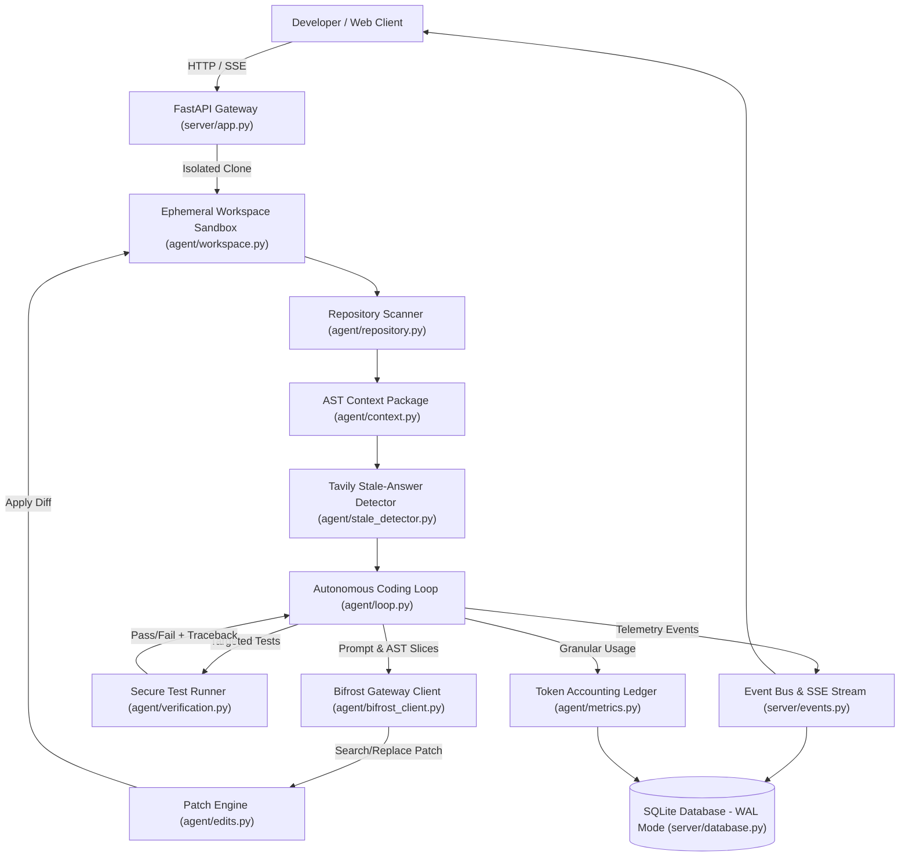

# TokenSlim — System Architecture Specification

## 1. Executive Overview

**TokenSlim** is an autonomous, token-efficient software engineering agent built with a specialized **Stale-Answer Detector**. It solves real coding defects by analyzing repositories, extracting minimal AST context slices, detecting and correcting deprecated API assumptions, generating targeted search-and-replace patches, and running tests within ephemeral sandboxes.

---

## 2. Core Architectural Components

### 2.1 Repository Intelligence & AST Mapper (`agent/repository.py`)
- **Lightweight AST Parsing:** Analyzes Python files using Python's standard `ast` module without heavyweight external indexers.
- **Structural Mapping:** Extracts top-level classes, methods, functions, decorators, line ranges, and module dependencies.
- **Resource Safeguards:**
  - Individual file size ceiling: `500 KB` (`MAX_FILE_BYTES`). Files larger than 500 KB are skipped to avoid memory exhaustion.
  - Cumulative repository scan ceiling: `20 MB` (`MAX_SCAN_BYTES`). Throws `ValueError` if total scanned code exceeds limit.
  - Max scanned file count: `1,000 files` (`MAX_FILES_COUNT`).
  - Symlink traversal protection: Symlinks pointing outside the repository root are ignored.

### 2.2 Selective Context Package (`agent/context.py`)
- **Token Efficiency Strategy:** Rather than dumping entire files into the model context (Naive Baseline), TokenSlim retrieves only the targeted AST slices corresponding to the failure site and relevant symbols.
- **Independent Limit Enforcement:** Slices enforce token limits, line limits, and character budgets simultaneously.
- **Partial Slice Annotation:** Truncated slices are explicitly labeled `// [PARTIAL SLICE: Lines X-Y of Total Z Lines]` to prevent the model from misinterpreting a slice as a complete function.
- **Accounting Integrity:** Token counts are explicitly labeled `is_estimated = True` using heuristic tiktoken cl100k estimators (`len(text) // 4` fallback).

### 2.3 Tavily Stale-Answer Detector (`agent/stale_detector.py`)
- **Objective:** Prevent agents from hallucinating deprecated syntax or out-of-date patterns (e.g., Pydantic v1 `.dict()` vs v2 `.model_dump()`).
- **Claim Extraction:** Parses incoming directives and code for library version assumptions, deprecated methods, and migration targets.
- **Heuristic Evidence Scoring:** Evaluates retrieved evidence against claims using an auditable heuristic strength score ($0.0$ to $1.0$).
- **Offline / Live Dual-Mode:**
  - If `TAVILY_API_KEY` is present and live network probing is enabled: executes live search.
  - If unconfigured: operates in heuristic simulation mode, explicitly flagged with `is_simulated = True`.

### 2.4 Autonomous Coding Loop (`agent/loop.py`)
- **Iterative Repair Cycle:**
  1. Baseline test execution to determine starting state.
  2. Repository mapping and minimal AST context extraction.
  3. Stale-answer verification and prompt enhancement.
  4. Minimal search-and-replace block generation via Bifrost.
  5. Atomic patch application to the ephemeral sandbox.
  6. Targeted test execution with failure excerpt extraction.
  7. **Early Stopping:** Halts immediately once all targeted tests pass.
- **Time & Budget Limits:** Enforces max repair iterations (default 4), token budget ceilings, and wall-clock execution limits.

### 2.5 Ephemeral Workspace Manager (`agent/workspace.py`)
- **Sandbox Isolation:** Clones target repositories to isolated directories in `%TEMP%\tokenslim_workspaces\run_<id>_\`.
- **Integrity Guarantee:** The original repository remains completely unmodified throughout execution.
- **Boundary Verification:** Rejects path traversal attempts (`../../`) and symlink escapes.
- **Automatic Cleanup:** Removes sandboxes upon run completion while preserving diffs and SQLite traces.

### 2.6 Secure Test Runner (`agent/verification.py`)
- **Executable Allowlist:** Restricts test execution strictly to permitted test runners (`python`, `python3`, `pytest`, `sys.executable`).
- **Shell Disarmament:** Strictly executes with `shell=False`, rejecting command-chaining operators (`&&`, `||`, `;`, `|`, `>`, `<`).
- **Process Tree Killing:** Recursively terminates process trees on Windows (`taskkill /F /T /PID`) and POSIX (`os.killpg`) to eliminate orphan worker leakage.
- **Credential Stripping:** Removes API keys and authorization headers from the subprocess environment before launch.

### 2.7 Granular Token Accounting Ledger (`agent/metrics.py`)
- **Strict Separation of Metrics:**
  - **Provider-Reported Usage:** Actual tokens returned by the LLM provider in HTTP response headers.
  - **Locally Estimated Usage:** Heuristic token estimates calculated prior to network requests.
  - **Simulated / Mock Usage:** Tokens produced by deterministic test harnesses or offline fallbacks.
- **Auditable Pricing Catalog:** Verified pricing entries in `USD per 1,000,000 tokens` with official documentation URLs and verification dates. Unknown models return `None` rather than assumed values.

### 2.8 Database & Event Telemetry (`server/database.py`, `server/events.py`)
- **SQLite WAL Mode:** Write-Ahead Logging (`PRAGMA journal_mode=WAL`) enables concurrent reads and writes without database lockups.
- **Sequential Event IDs:** Every telemetry event is assigned an autoincrementing database ID.
- **Reconnection Recovery:** `GET /api/runs/{run_id}/events` accepts `Last-Event-ID` and replays all missed events in strict chronological order before streaming live events.
- **Crash Recovery:** Application lifespan startup automatically updates orphaned `running` rows to `interrupted`.

---

## 3. Data Flow & Event Contract

### Standardized Event Types
| Event Type | Payload Data | Trigger Condition |
| :--- | :--- | :--- |
| `state_change` | `status`, `configuration`, `is_replay` | Run state transitions (initialized, completed, cancelled, failed). |
| `start` | `task_directive`, `budget` | Coding loop begins execution. |
| `baseline_test` | `passed`, `failing_tests`, `concise_summary` | Initial test suite runs before edits. |
| `repo_scanned` | `files_count`, `total_lines` | Repository AST scanner completes file index. |
| `stale_detection`| `claims_count`, `stale_count`, `claims` | Stale-answer detector inspects API syntax. |
| `context_selected`| `estimated_tokens`, `slices_count` | Selective AST slices extracted for prompt context. |
| `model_call` | `model`, `tokens`, `is_simulated`, `cost` | LLM invocation through Bifrost completes. |
| `patch_applied` | `file_path`, `diff` | PatchEngine applies atomic replacement block. |
| `test_executed` | `passed`, `summary`, `duration` | Targeted tests run against patched sandbox. |
| `metrics` | `total_tokens`, `provider_tokens`, `is_simulated`| Final run token and iteration metrics. |
| `diff` | `diff` | Full unified diff exported for review. |
| `finish` | `status`, `iterations`, `tests_passed` | Loop completes with verified resolution. |
| `cancelled` | `status` | User cancels run via POST `/api/runs/{id}/cancel`. |
| `stream_closed` | `status`, `message` | SSE stream concludes. |
